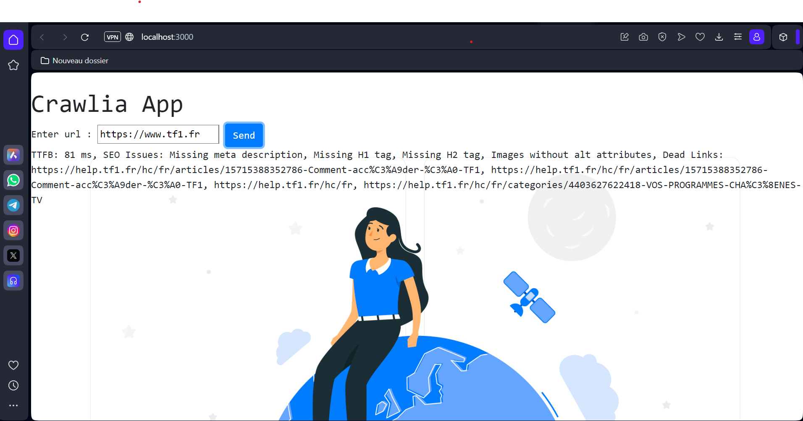

# Crawlia

**Crawlia** is a simple and lightweight **web scraping** app built with **Node.js**.  
It features a minimalist interface with a single input field where you can enter any URL you want to analyze.

Once you submit the form, the app performs an analysis and displays a clear and informative **SEO report**.

---

## Analysing the page

crawlia analyse : 

```text
- TTFB ( response time from the server in ms ).
- Does the document has SEO attribute such as meta-description, h1, h2 etc… ?
- Does the page include deadlinks ? ( 404 urls in the page for example ).
```
### Example




## How to execute the code 

 Initialize the Project:
```
npm init -y
```

 Install dependencies :
```
npm install express 
```

 Launch Application :
```
node app.js
```

 Open your browser and go to :
```
http://localhost:3000
```
Enter a URL to analyze and view the results.


